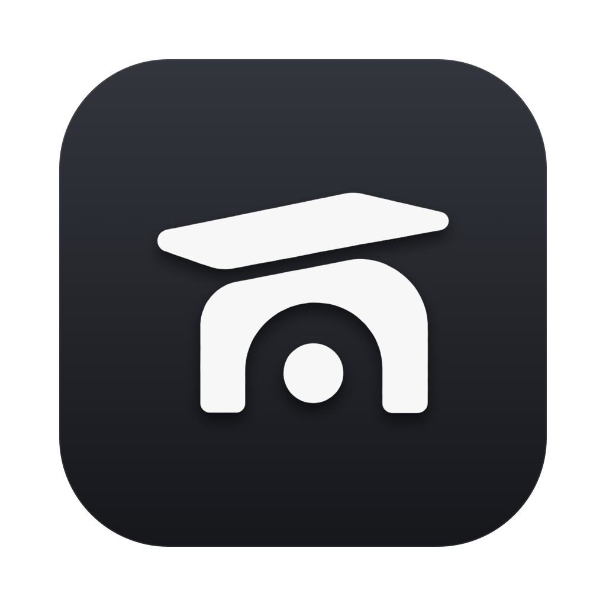

<p align="center">
  
</p>

<h1 align="center">Mantel</h1>

<p align="center">
  One menu bar app for the Mac tools I actually use.<br>
  Everything is a switch: turn on what you want, leave the rest off.
</p>

## What it is

Mantel is the shelf above the fireplace: one place for the few tools you keep within reach. I was running six apps for my menu bar, notch, Dock and keyboard, so I put them together in one app I control.

**Mantel is a combination of open source apps.** It is a fork of [Vorssaint](https://github.com/vorssaint/vorssaint-utils), with features rebuilt from four others on top of it:

| From | What Mantel takes | License |
|---|---|---|
| [Vorssaint](https://github.com/vorssaint/vorssaint-utils) by Vorssaint | The base: settings, Features hub, Dock previews, window switcher, Dynamic Island and dozens of tools | GPL-3.0 |
| [Boring Notch](https://github.com/TheBoredTeam/boring.notch) by TheBoredTeam | The notch design: shape, music player, calendar and reminders, shelf, HUD, battery | GPL-3.0 |
| [DockDoor](https://github.com/ejbills/DockDoor) by Ethan Bills | Dock extras: window buttons, swipes, shake, scroll actions, Folder Pop, live previews and more | GPL-3.0 |
| [Ice](https://github.com/jordanbaird/Ice) by Jordan Baird | Hiding menu bar icons behind one icon | GPL-3.0 |
| [Mac Duo](https://github.com/DhananjayBhosale/MacDuo) by Dhananjay Bhosale | The lid animation: the desktop follows the lid as it closes | MIT |

Plus one thing of its own: **Type Clipboard** types the clipboard as keystrokes, for fields that block pasting.

Mantel is not affiliated with or endorsed by any of these projects. If something breaks in Mantel, please report it here, not to them.

## Install

1. Download `Mantel.zip` from the [latest release](../../releases/latest) and unzip it.
2. Drag Mantel into your Applications folder and open it.
3. macOS says it can't check the app, because Mantel is not signed by a registered Apple developer. Click Done, then go to System Settings, Privacy & Security, scroll down and click Open Anyway.
4. Mantel sits in the menu bar. Open its settings, go to Features and switch on what you want. Each feature asks for the permission it needs.

Mantel doesn't update itself: download the new release when there is one.

Needs a Mac with Apple Silicon and macOS 14 or newer.

## Build it yourself

```sh
git clone https://github.com/tismalarosta/mantel.git
cd mantel
./build.sh --dev
open build/stage.noindex/Mantel.app
```

Xcode Command Line Tools are the only requirement. The first build creates a local signing certificate called "Mantel Signing", so macOS keeps your permissions between builds. `./build.sh --friends` makes the zip that goes on the releases page.

Mantel's own code lives in `Sources/Vorssaint/Mantel/`, one folder per feature. Changes to Vorssaint's files are small hooks marked `// Mantel`, so the fork can keep merging Vorssaint's updates. Vorssaint's original README is in [docs/VORSSAINT-README.md](docs/VORSSAINT-README.md).

## Privacy

Like Vorssaint, Mantel has no account, analytics or tracking. Vorssaint's temporary screenshot and recording links are switched off in Mantel, because they upload to Vorssaint's own server, and Send Feedback opens this repository's issues instead.

## License

[GPL-3.0 or later](LICENSE), like Vorssaint, Boring Notch, DockDoor and Ice. The code ported from Mac Duo keeps its MIT notice next to it ([LICENSE-MacDuo.txt](Sources/Vorssaint/Mantel/LidAnimation/LICENSE-MacDuo.txt)), and every ported file credits the project it comes from.

Following Vorssaint's [TRADEMARKS.md](TRADEMARKS.md), Mantel has its own name, icon, bundle identifier and signing identity, and does not use Vorssaint's update feed.
